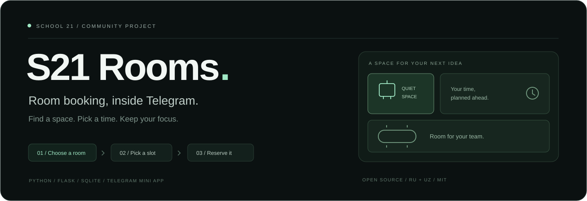
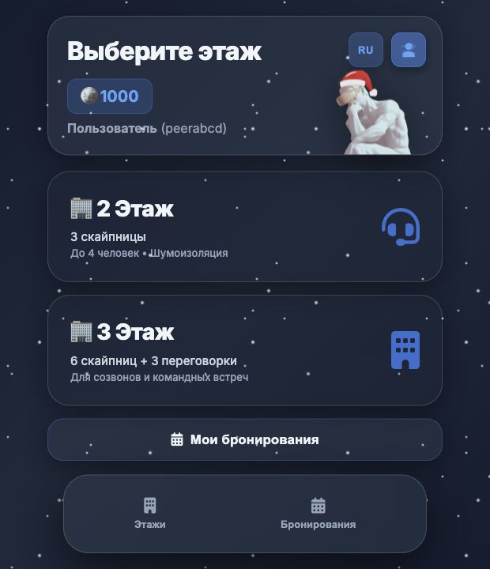
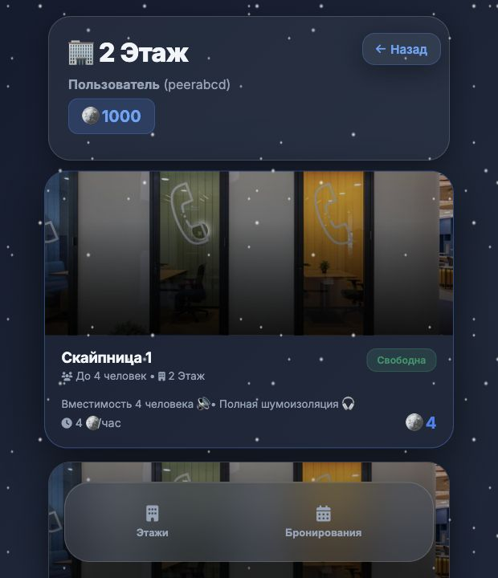

<p align="center">
  
</p>

<p align="center"><a href="README.md">Русский</a> · <strong>English</strong></p>

<h1 align="center">S21 Rooms</h1>

<p align="center">
  <strong>Less room hunting. More time to build.</strong><br />
  An open-source Telegram bot and Mini App for the School 21 peer community.
</p>

<p align="center">
  <a href="https://github.com/fluxo159/school21-bot/actions/workflows/tests.yml"></a>
  <a href="https://www.python.org/"></a>
  <a href="LICENSE"></a>
  <a href="https://github.com/fluxo159/school21-bot/commits/main"></a>
  <a href="CONTRIBUTING.md"></a>
</p>

<p align="center">
  <a href="#preview">Preview</a> ·
  <a href="#features-available-today">Features</a> ·
  <a href="#quick-start">Quick start</a> ·
  <a href="#roadmap">Roadmap</a> ·
  <a href="CONTRIBUTING.md">Contribute</a>
</p>

---

Find an available Skype booth or meeting room, reserve a slot, and manage your bookings without leaving Telegram. Built for the daily rhythm of peer-to-peer learning at School 21.

**Independent community project.** Room reservations and internal booking credits are implemented today. Evaluation-point tracking, peer-review schedules and campus notifications are on the [roadmap](#roadmap). This project is not an official School 21 service.

## Preview

<table>
  <tr>
    <th>Choose your space</th>
    <th>Find an available room</th>
  </tr>
  <tr>
    <td width="50%"></td>
    <td width="50%"></td>
  </tr>
</table>

*Screenshots from the local demo, using a synthetic profile. The Mini App includes Russian and Uzbek interface translations.*

## Why it exists

During an intense coding bootcamp, finding a quiet room for a call, an interview, or a peer discussion should not require walking between floors or coordinating in several chats. This project brings room availability and personal reservations into one mobile interface inside Telegram.

## Features available today

- `/start` opens the booking Mini App; a Telegram menu button makes it easy to return.
- Browse Skype booths and meeting rooms on floors 2 and 3, with room photos and capacity.
- See occupied slots and periodically refreshed room status.
- Create future reservations, including slots that cross midnight, with transaction-protected conflict checks.
- View personal bookings and cancel more than one hour before the start, with an atomic credit refund.
- Register a School 21 login and an Uzbekistan-format phone number.
- Track **internal booking credits**; these are separate from School 21 evaluation points. New accounts currently receive 1000 credits, and each reservation debits the room's configured price once.
- Use Russian and Uzbek interface translations.
- Allowlisted administrators can view recent activity and weekly room-usage reports.
- Verify Telegram Mini App signatures on the server, with an isolated local browser demo for contributors.

## Roadmap

> **Project vision:** An open-source Telegram automation bot built for the School 21 peer-to-peer developer community to track evaluation points, monitor peer-review schedules, and receive real-time campus notifications.
>
> These campus integrations are planned; the current release focuses on room booking.


- [ ] Evaluation-point tracking through an authorized campus integration.
- [ ] Peer-review schedules and opt-in reminders.
- [ ] Opt-in campus announcements and booking notifications.
- [ ] Campus membership verification beyond self-entered profile fields.
- [ ] Privacy controls, account deletion and a documented retention policy.
- [ ] Stronger deployment controls: rate limits, monitoring and broader browser accessibility coverage.

Ideas from peers are welcome in [Issues](https://github.com/fluxo159/school21-bot/issues). Please include a concrete workflow and avoid posting private campus or student data.

## Architecture

```text
Telegram /start  →  HTTPS Mini App
                         │ signed Telegram initData
                         ▼
                   Flask JSON API  →  SQLite
                         │
                   HTML / CSS / JS
```

| Component | Technology and responsibility |
| --- | --- |
| Bot | Python 3.10+, `python-telegram-bot` 22.x; async command and startup handlers, long polling |
| Web server | Flask; synchronous request handlers served by Gunicorn in deployment |
| Storage | Standard-library SQLite, WAL mode, write transactions and parameterized SQL |
| Frontend | Vanilla JavaScript, HTML and CSS, Telegram Web Apps SDK; no Node build required |
| Configuration | `python-dotenv`; environment variables override the root `.env` file |
| Tests | Standard-library `unittest`, temporary databases and mocked Telegram calls |

```text
bot.py                    Telegram entry point
backend/app.py            HTTP routes and authorization
backend/config.py         Environment and campus timezone
backend/security.py       Signed Telegram identity validation
backend/database.py       Schema, migration and example rooms
backend/models.py         Persistence and booking transactions
backend/login_validator.py  Peer-login validation
frontend/                 Mini App, translations and assets
tests/                    Security and booking regression tests
docs/deployment.md        Hosting and data-storage notes
```

## Quick start

Install Python 3.10 or newer. Gunicorn runs on Unix-like systems; the local Flask server also works on Windows.

```bash
git clone https://github.com/fluxo159/school21-bot.git
cd school21-bot
python3 -m venv venv
source venv/bin/activate
# Windows PowerShell: .\venv\Scripts\Activate.ps1
python -m pip install -r requirements.txt
cp .env.example .env
```

### 1. Preview locally, without a Telegram token

In `.env`, set `DEMO_MODE=true`, then run:

```bash
python -m backend.app
```

Open [http://127.0.0.1:5001](http://127.0.0.1:5001). The schema and 12 example rooms are created automatically. Register a synthetic eight-letter login such as `peerabcd` and use dummy data for the phone field.

Demo mode accepts loopback requests only, uses a fixed synthetic Telegram identity, disables administrative access, and defaults to `instance/demo.db`. Keep `DATABASE_PATH` unset for this demo so it stays separate from campus data. Do not expose a demo server through a tunnel or deploy it.

### 2. Run through Telegram

Create a bot with [@BotFather](https://t.me/BotFather), host the Flask application at an HTTPS address, and edit your private `.env`:

```dotenv
TELEGRAM_BOT_TOKEN=replace-with-your-bot-token
BACKEND_URL=https://your-school21-app.example.com
DEMO_MODE=false
ADMIN_TELEGRAM_IDS=
```

Set `ADMIN_TELEGRAM_IDS` to a comma-separated list of real administrators' numeric Telegram IDs if admin reporting is needed. The login `admin` and phone numbers do not grant privileges.

Start the web server and, in a second activated terminal, start the bot:

```bash
# Terminal 1: local server; Telegram needs an HTTPS endpoint forwarding to it.
python -m backend.app

# Terminal 2:
python bot.py
```

Open a private chat with your bot, send `/start`, and tap **Открыть**. `BACKEND_URL` must reach the server over HTTPS; a localhost URL alone cannot be opened by Telegram clients on other devices. For a public deployment, see [deployment instructions](docs/deployment.md).

Telegram identity comes from validated `initData`, not a URL parameter or an entered login/phone. Legacy profiles tied to a different Telegram ID need an operator-assisted migration; entering a phone number cannot take over another account.

### Configuration

All settings and comments are in [`.env.example`](.env.example). Important optional settings:

| Variable | Default | Purpose |
| --- | --- | --- |
| `DATABASE_PATH` | `backend/school21.db`, or `instance/demo.db` in demo mode | SQLite file; relative paths resolve from the repository root |
| `TZ` | `Asia/Tashkent` | Campus wall time for reservations |
| `PORT` | `5001` locally | HTTP listener port |
| `INIT_DATA_MAX_AGE` | `86400` | Signed Telegram session lifetime in seconds |
| `WEB_CONCURRENCY` | `2` | Gunicorn worker count |
| `FLASK_DEBUG` | `false` | Local development only |

## Development and verification

```bash
python -m unittest discover -s tests -v
python -m compileall -q backend bot.py
# Optional, when Node.js is installed:
node --check frontend/api.js
node --check frontend/app.js
node --check frontend/booking.js
```

Tests use temporary databases and synthetic identities. They do not poll Telegram or send messages. CI checks supported Python versions on every push and pull request.

## Security and operational status

The project is actively maintained and has regression tests, but it has not undergone an independent security audit. Before serving a real campus, review the [deployment guide](docs/deployment.md) and [security policy](SECURITY.md), configure HTTPS and persistent storage, and decide what personal data the campus actually needs to collect. Profile fields are self-entered and do not prove School 21 membership.

Never commit `.env`, SQLite files, student exports, logs or bot tokens. Report vulnerabilities privately through GitHub's repository security reporting feature when available; do not publish an exploit or personal data in an issue.

## Contributing

School 21 peers and outside contributors are welcome. A first contribution can be a clearer translation, a reproducible bug report, a documentation fix or a focused regression test.

- [Report a bug](https://github.com/fluxo159/school21-bot/issues/new?template=bug_report.yml)
- [Suggest a feature](https://github.com/fluxo159/school21-bot/issues/new?template=feature_request.yml)
- [Read the contribution guide](CONTRIBUTING.md)

Fork the repository, make a focused change and open a pull request with verification notes. No contribution is too small to be useful to another peer.

## License

[MIT License](LICENSE) · Copyright © 2026 Abdujamil Aydarbekov.

<p align="center">
  Built for peers, with room to grow.<br />
  <a href="#s21-rooms">Back to top ↑</a>
</p>
