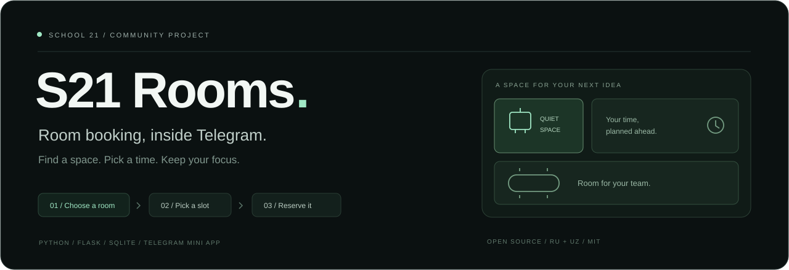
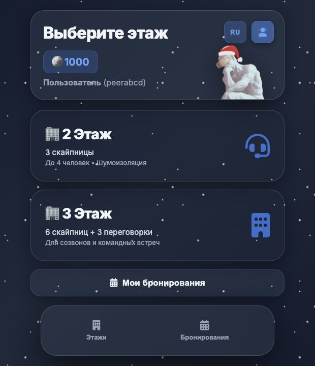
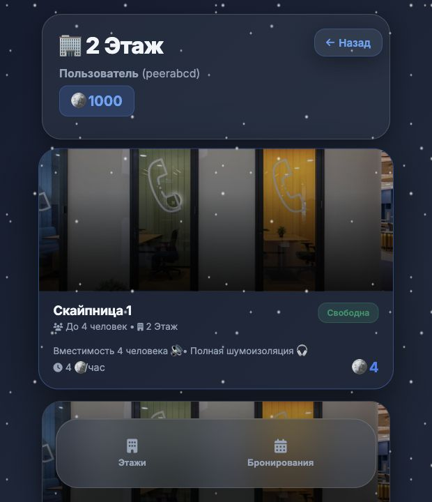

<p align="center">
  
</p>

<p align="center"><strong>Русский</strong> · <a href="README.en.md">English</a></p>

<h1 align="center">S21 Rooms</h1>

<p align="center">
  <strong>Меньше поисков комнаты. Больше времени на работу.</strong><br />
  Telegram-бот и Mini App для бронирования скайпниц и переговорных School 21.
</p>

<p align="center">
  <a href="https://github.com/fluxo159/school21-bot/actions/workflows/tests.yml"></a>
  
  
  
  <a href="LICENSE"></a>
</p>

<p align="center">
  <a href="#интерфейс">Интерфейс</a> ·
  <a href="#возможности">Возможности</a> ·
  <a href="#как-устроено">Как устроено</a> ·
  <a href="#развитие">Развитие</a> ·
  <a href="CONTRIBUTING.md">Участие в проекте</a>
</p>

---

## О проекте

Найти свободную комнату для звонка, собеседования или совместной работы, выбрать время и управлять бронями — всё в одном интерфейсе внутри Telegram.

**Независимый проект сообщества School 21.** Сейчас реализованы бронирование комнат и внутренние кредиты для бронирований. Учёт официальных баллов, расписание пировых проверок и уведомления кампуса относятся к планам развития. Проект не является официальным сервисом School 21.

## Интерфейс

<table>
  <tr>
    <th width="50%">Выберите пространство</th>
    <th width="50%">Найдите свободную комнату</th>
  </tr>
  <tr>
    <td></td>
    <td></td>
  </tr>
</table>

<p align="center"><sub>Скриншоты локального демо с тестовыми данными. Интерфейс доступен на русском и узбекском языках.</sub></p>

## Возможности

| Для участника | Для организации работы |
| --- | --- |
| Открытие Mini App через `/start` или меню бота. | Скайпницы и переговорные на 2-м и 3-м этажах. |
| Выбор комнаты, просмотр фото и вместимости. | Проверка пересечений бронирований внутри транзакции. |
| Свободные и занятые слоты, бронь с переходом через полночь. | Периодическое обновление занятости комнат. |
| Список своих броней и отмена более чем за час до начала. | Атомарный возврат внутренних кредитов при отмене. |
| Регистрация логина и телефона, русский и узбекский интерфейс. | Отчёты для администраторов из списка разрешённых Telegram ID. |

При регистрации начисляются **1000 внутренних кредитов**. Бронирование списывает настроенную стоимость комнаты один раз. Эти кредиты не связаны с официальными баллами School 21.


## Как устроено

```text
Telegram /start
      │
      ▼
Mini App · HTML / CSS / JavaScript
      │ подписанный initData
      ▼
Flask JSON API ── SQLite
```

| Часть | Технология |
| --- | --- |
| Telegram-бот | `python-telegram-bot` 22.x, асинхронные обработчики, long polling. |
| Сервер | Flask 3.1; для размещения — Gunicorn. |
| Хранилище | SQLite: WAL, транзакции и параметризованные запросы. |
| Интерфейс | JavaScript, HTML, CSS и Telegram Web Apps SDK; сборка Node.js не нужна. |
| Проверки | `unittest`, временные базы и тестовые Telegram-пользователи. |


## Проверки

```bash
python -m unittest discover -s tests -v
python -m compileall -q backend bot.py
```

Дополнительно, если установлен Node.js:

```bash
node --check frontend/api.js
node --check frontend/app.js
node --check frontend/booking.js
node --check frontend/translations.js
```

Тесты используют временные базы и тестовые данные; сообщения в Telegram не отправляются. [GitHub Actions](.github/workflows/tests.yml) выполняет проверки на Python 3.10, 3.12 и 3.13 при push и pull request.

## Структура

```text
bot.py                   # Команда /start и меню Mini App
backend/
├── app.py               # Маршруты API и проверка прав доступа
├── config.py            # Настройки и часовой пояс
├── security.py          # Проверка подписанного Telegram initData
├── database.py          # Схема, миграции и примерные комнаты
└── models.py            # Бронирования, пользователи и транзакции
frontend/                # Mini App, переводы и изображения
tests/                  # Регрессионные проверки
docs/deployment.md      # Размещение и хранение данных
```

## Развитие

- [ ] Учёт официальных баллов через разрешённую интеграцию кампуса.
- [ ] Расписание пировых проверок и уведомления по подписке.
- [ ] Проверка принадлежности к кампусу.
- [ ] Управление личными данными и удалением аккаунта.
- [ ] Ограничение запросов, мониторинг и расширение проверок доступности.

## Документация и участие

- [Безопасность](SECURITY.md) — подписанная Telegram-идентификация, права доступа и сообщения об уязвимостях.
- [Руководство участника](CONTRIBUTING.md) — предложения изменений и проверка перед pull request.
- [Сообщить об ошибке](https://github.com/fluxo159/school21-bot/issues/new?template=bug_report.yml) · [Предложить функцию](https://github.com/fluxo159/school21-bot/issues/new?template=feature_request.yml).

Идентификация выполняется по проверенному `initData`. Логин `admin`, введённый логин или телефон не дают административных прав и не подтверждают членство в School 21. Проект не проходил независимый аудит безопасности. Не добавляйте в репозиторий `.env`, токены, реальные базы, выгрузки и персональные данные. Перед использованием с реальными данными ознакомьтесь с политикой безопасности.

## Лицензия

[MIT](LICENSE) · © 2026 Абдужамил Айдарбеков.

<p align="center">
  Создано для пиров и совместной работы.<br />
  <a href="#s21-rooms">Наверх ↑</a> · <a href="README.en.md">English documentation</a>
</p>
